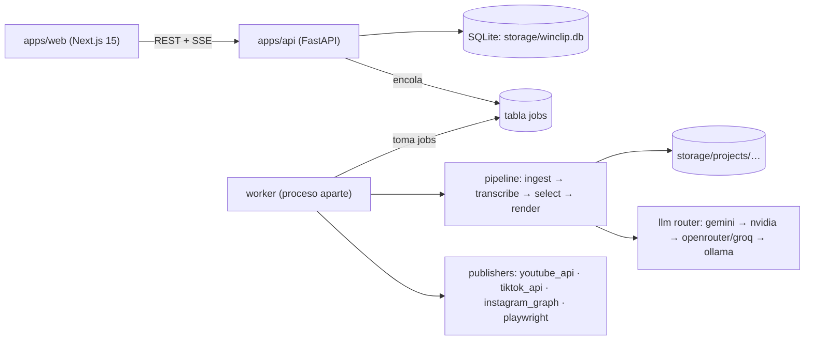
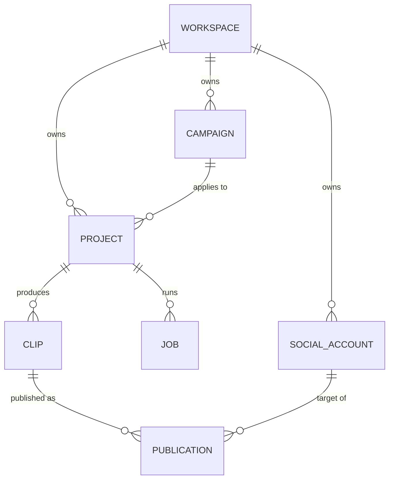

# WinClip: arquitectura y contratos entre changes

Este documento es la **fuente de verdad compartida** para todos los changes de OpenSpec.
Si un change necesita alterar un contrato de aquí, debe actualizar este archivo en el mismo change.

## 1. Vista general



## 2. Hoja de ruta (changes de OpenSpec)

| # | Change | Capabilities (specs) | Depende de |
|---|---|---|---|
| 0 | `setup-foundation` | `dev-environment`, `repo-security` | — |
| 1 | `add-ingest-transcription` | `media-ingest`, `transcription` | 0 |
| 2 | `add-clip-selection-llm` | `llm-gateway`, `clip-selection` | 1 |
| 3 | `add-render-reframe-subtitles` | `vertical-reframe`, `subtitle-rendering`, `clip-render` | 2 |
| 4 | `add-api-jobs` | `job-queue`, `projects-api` | 3 |
| 5 | `add-web-ui-cards` | `web-dashboard`, `clip-review` | 4 |
| 6 | `add-campaign-rules` | `campaign-rules` | 2, 5 |
| 7 | `add-social-accounts` | `social-accounts` | 4 (UI con 5) |
| 8 | `add-publishers` | `publishing` | 6, 7 |

Los changes 1–3 entregan **solo CLI** (`winclip …`) para validar la calidad del pipeline antes de construir la API y la UI.

## 3. Estructura de carpetas

```
apps/api/
  pyproject.toml            # uv, python 3.12, paquete "winclip"
  winclip/
    core/        config.py (Settings), db.py, models.py, storage.py, logging.py, ids.py
    pipeline/    ingest.py, transcribe.py, segment.py, select.py, reframe.py, subtitles/, render.py
    llm/         router.py, providers/{gemini,nvidia,openrouter,groq,ollama}.py, prompts/
    rules/       schema.py, parser.py, validator.py
    publishers/  base.py, youtube_api.py, tiktok_api.py, instagram_graph.py, playwright/{session,tiktok,instagram}.py
    worker/      queue.py, runner.py, handlers.py
    routers/     health.py, projects.py, clips.py, campaigns.py, accounts.py, publications.py, events.py
    cli.py       # Typer: winclip doctor|ingest|transcribe|select|render|run|worker
  tests/
apps/web/        # Next.js
packages/api-client/  # generado: openapi-typescript + openapi-fetch
assets/fonts/    # OFL: Montserrat, Poppins, Anton, Bebas Neue, League Spartan, Inter, Noto Emoji
assets/subtitle-presets/*.json
storage/         # gitignored
```

## 4. Configuración (`.env`, lo carga `core/config.py`)

| Variable | Default | Notas |
|---|---|---|
| `APP_NAME` | `WinClip` | Marca visible configurable |
| `STORAGE_DIR` | `./storage` | Raíz de datos (en la máquina del autor: `/Volumes/yohan/Proyectos/winclip/storage` vía `.env` local) |
| `DATABASE_URL` | `sqlite:///{STORAGE_DIR}/winclip.db` | Si no se define, se deriva automáticamente de `STORAGE_DIR` |
| `FFMPEG_BIN` / `FFPROBE_BIN` | `/opt/homebrew/opt/ffmpeg-full/bin/ffmpeg` / `…/ffprobe` | Obligatorio que tenga libass |
| `YTDLP_BIN` | `yt-dlp` | Se usa el paquete Python; el binario es respaldo |
| `WHISPER_MODEL` | `mlx-community/whisper-large-v3-turbo` | |
| `GEMINI_API_KEY`, `NVIDIA_API_KEY`, `OPENROUTER_API_KEY`, `GROQ_API_KEY` | vacío | Opcionales; el router salta a los proveedores que no tengan clave |
| `LLM_PROVIDER_ORDER` | `gemini,nvidia,openrouter,groq,ollama` | |
| `OLLAMA_HOST` | `http://localhost:11434` | |
| `GOOGLE_CLIENT_SECRET_FILE` | vacío | Ruta al client_secret OAuth (fuera del repo) |
| `TIKTOK_CLIENT_KEY` / `TIKTOK_CLIENT_SECRET` | vacío | |
| `META_APP_ID` / `META_APP_SECRET` | vacío | Instagram Graph |
| `WINCLIP_SECRET_KEY` | vacío | Opcional: override de la clave Fernet para cifrar tokens (por defecto usa Keychain vía `keyring`) |
| `USER_FONTS_DIR` | `~/Library/Fonts` | Fuentes locales no redistribuibles (Gotham) |
| `API_PORT` / `WEB_PORT` | `8000` / `3000` | |

## 5. Layout de almacenamiento por proyecto

```
storage/projects/<project_id>/
  source/original.<ext>        # descargado o subido
  source/meta.json             # ffprobe + metadatos de yt-dlp
  audio/audio16k.wav
  transcript/transcript.json   # contrato §6.1
  selection/candidates.json    # contrato §6.2
  clips/<clip_id>/clip.mp4, thumb.jpg, subs.ass, render.json (contrato §6.3)
storage/accounts/<account_id>/ # tokens OAuth cifrados o perfil de Playwright (gitignored)
storage/cache/llm/<sha256>.json
```

IDs: ULID en minúsculas (`core/ids.py`).

## 6. Contratos de datos (JSON en disco = modelos Pydantic)

### 6.1 `transcript.json`
```json
{
  "language": "es",
  "duration": 3725.4,
  "model": "mlx-community/whisper-large-v3-turbo",
  "segments": [
    {"id": 0, "start": 0.0, "end": 4.2, "text": "Hola a todos…",
     "words": [{"w": "Hola", "s": 0.00, "e": 0.31, "p": 0.98}]}
  ]
}
```

### 6.2 `candidates.json`
```json
{
  "project_id": "…", "campaign_id": null, "requested": 10, "provider": "gemini:gemini-flash",
  "candidates": [
    {"id": "…", "start": 812.4, "end": 861.0, "title": "…", "hook": "…",
     "description": "…", "hashtags": ["#…"], "score": 87, "reason": "…",
     "language": "es", "rule_violations": []}
  ]
}
```
Tipos y contrato: `requested` acepta `int | "max"`. Cada elemento de `rule_violations` es un objeto `RuleViolation`: `{"code": str, "field": str, "severity": "warning" | "error", "message": str}`.
Invariantes: sin solapes, `min_dur ≤ end-start ≤ max_dur`, cortes alineados con límites de palabra, ordenados por `score` de mayor a menor.

### 6.3 `render.json` (por clip)
```json
{"clip_id": "…", "candidate_id": "…", "width": 1080, "height": 1920, "fps": 30,
 "reframe": {"mode": "face", "track": [[0.0, 0.42], [1.0, 0.45]]},
 "subtitles": {"engine": "ass", "preset": "bold-yellow", "font": "Montserrat ExtraBold"},
 "hook_overlay": true, "duration": 48.6, "output": "clip.mp4", "thumbnail": "thumb.jpg"}
```
`reframe.mode` acepta `"face" | "center" | "blur" | "passthrough"` (`passthrough` cuando el video fuente ya es vertical 9:16).

### 6.4 Esquema de reglas de campaña (`rules/schema.py`)
`name, language (es|en|auto), min_duration, max_duration, max_clips, priority_topics[], banned_topics[], banned_words[], required_keywords[], tone, hook_max_seconds, cta_text, hashtags[], subtitle_preset, watermark_path, target_platforms[], extra_instructions`.

## 7. Modelo de datos (SQLite, SQLModel)



- `workspace` (id, name). Hoy existe una sola, la por defecto (preparado para SaaS).
- `project` (id, workspace_id, campaign_id?, source_type url|file, source_url?, title, status, requested_clips, language, duration, created_at).
- `clip` (id, project_id, candidate json, status draft|rendered|failed, title, description, hashtags, score, path, thumb_path).
- `job` (id, project_id?, type, payload json, status queued|running|done|failed|cancelled, progress 0–100, stage, error, attempts, timestamps).
- `campaign` (id, workspace_id, name, rules json, source_text).
- `social_account` (id, workspace_id, platform youtube|tiktok|instagram, display_name, handle, auth_method api|playwright, credentials_ref, status, last_check_at).
- `publication` (id, clip_id, account_id, status scheduled|publishing|published|failed, scheduled_at, external_id, external_url, error, screenshot_path).

## 8. Interfaces clave (Python)

```python
class LLMProvider(Protocol):
    name: str
    def available(self) -> bool: ...
    def complete_json(self, system: str, user: str, schema: type[BaseModel]) -> BaseModel: ...

class Publisher(Protocol):
    platform: Literal["youtube", "tiktok", "instagram"]
    def check(self, account: SocialAccount) -> AccountStatus: ...
    def publish(self, clip: Clip, account: SocialAccount, meta: PublishMeta) -> PublishResult: ...

class Storage(Protocol):  # local hoy, S3 mañana
    def path(self, *parts: str) -> Path: ...
```

## 9. Fuentes OFL incluidas (presets de subtítulos)

Montserrat (Black/ExtraBold), Poppins (Bold/Black), Anton, Bebas Neue, League Spartan (Black), Inter, Noto Color Emoji. Son las más usadas en estilos tipo Hormozi y MrBeast. Gotham y otras comerciales solo se usan vía `USER_FONTS_DIR`.
